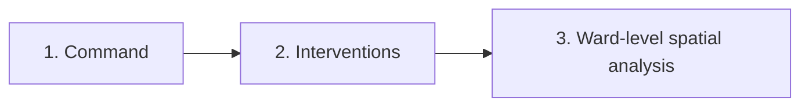
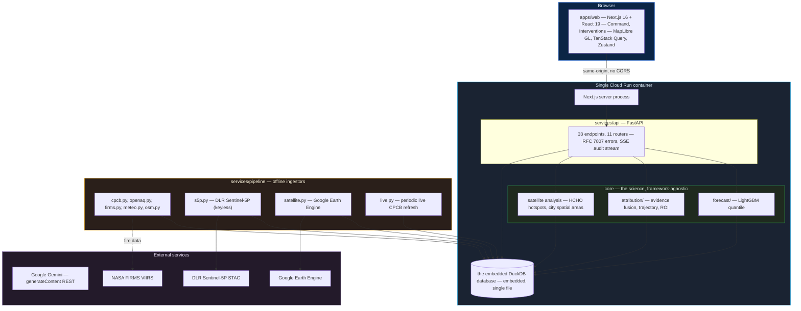
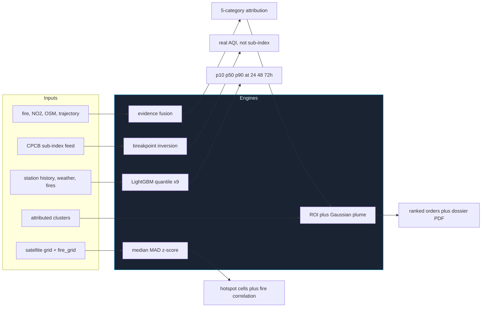
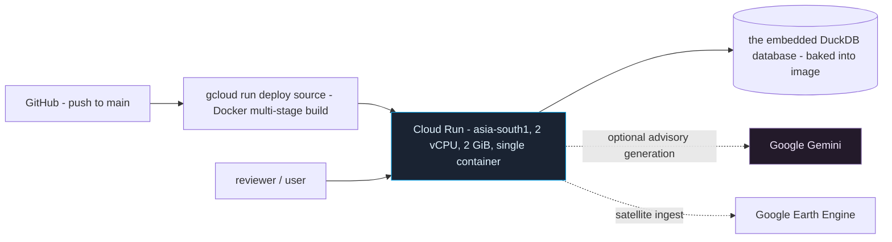

<div align="center">

# Aeris — Pune & Delhi Air-Quality Intelligence

**Aeris turns air-quality data for Pune and Delhi into ward-level intelligence, forecasts, source attribution, and evidence-led interventions.**

*Aeris — a two-city air-quality intelligence platform for Pune and Delhi.*

[](#study-areas-pune-and-delhi)
[](#testing)
[](#study-areas-pune-and-delhi)
[](requirements.txt)
[](apps/web/package.json)

**Pune + Delhi study areas** · **Ward-level analysis** · **Air-quality forecasting**


`air-quality` · `environmental-monitoring` · `machine-learning` · `computer-vision` · `satellite-imagery`
`google-gemini` · `google-earth-engine` · `sentinel-5p` · `lightgbm` · `duckdb`
`fastapi` · `nextjs` · `maplibre` · `google-cloud-run`
`gaussian-plume` · `india` · `gov-data` · `enforcement` · `project`

</div>

---

<div align="center">

| | | | | |
|:--:|:--:|:--:|:--:|:--:|
| **Pune + Delhi** | **AQI** | **Forecast** | **Attribution** | **Interventions** |
| City-specific ward cells | satellite pollutant channels | ward-level spatial analysis | fire detections where available | ranked interventions |

*Current model metrics in this project are from Delhi; Pune performance must not be claimed until verified Pune observations are evaluated.*

</div>

---

## Table of contents

- [The problem](#the-problem)
- [What Aeris does](#what-aeris-does)
- [A five-minute tour](#a-five-minute-tour)
- [Screens](#screens)
- [System architecture](#system-architecture)
- [Request lifecycle](#request-lifecycle)
- [How Aeris actually works](#how-aeris-actually-works)
  - [1 · CPCB AQI conversion](#1--cpcb-aqi-conversion--and-the-sub-index-inversion-bug-it-fixes)
  - [2 · Short-term forecast](#2--short-term-forecast--lightgbm-quantile-regression)
  - [3 · Source attribution](#3--source-attribution--multi-evidence-fusion)
  - [4 · Ranked interventions](#4--ranked-interventions--roi--gaussian-plume-counterfactual)
  - [5 · National satellite grid & HCHO hotspots](#5--national-satellite-grid--hcho-hotspot-detection)
- [The data pipeline](#the-data-pipeline)
- [Model registry](#model-registry)
- [Training and evaluation](#training-and-evaluation)
- [Two bugs found by testing, not by reading](#two-bugs-found-by-testing-not-by-reading)
- [The dataset](#the-dataset)
- [Data sources & API keys](#data-sources--api-keys)
- [Deployment](#deployment)
- [How Aeris differs](#how-aeris-differs)
- [Tech stack](#tech-stack)
- [Getting started](#getting-started)
- [Environment variables](#environment-variables)
- [Project structure](#project-structure)
- [Testing](#testing)
- [API reference](#api-reference)
- [Known limitations](#known-limitations)
- [Roadmap](#roadmap)
- [License](#license)

---

## Study areas: Pune and Delhi

Aeris is designed for two study areas: Pune, Maharashtra, and Delhi. Each city must use its own boundary, station registry, data filters, and configuration; observations must never be silently substituted across cities. Pune-specific ground observations were not present in the training/evaluation dataset used for the current reported model metrics. The available LightGBM training/evaluation results are for Delhi only. Do not present those results as Pune validation. Ward-level outputs depend on the selected boundary dataset. Station readings are measurements; interpolated ward values and forecasts are estimates; generated fixtures are synthetic/demo data. Keep these categories visibly distinct.

## The problem

India runs 900+ CAAQMS air-quality monitoring stations, yet a 2024 CAG audit
found **69% of monitored cities have no actionable response protocol**
connected to those readings.

| Today | Consequence |
|---|---|
| CPCB SAMEER measures, but does not act | A reading with no owner and no deadline |
| SAFAR forecasts, but only 4 cities | Everywhere else flies blind on tomorrow |
| IITM's Pune DSS attributes sources — Pune, winter-only, resource-intensive | Not something a smaller city, or a different season, can run |
| No system unifies evidence across data sources | Pollution signals are fragmented across feeds; no ward-level picture does |

Aeris brings these capabilities to Pune and Delhi, combining city-level observations with spatial, satellite, and meteorological evidence where available. Source coverage and validation status must be stated separately for each city.

## What Aeris does

<table>
<tr><td width="33%" valign="top">

### 🏙️ City enforcement loop

**Decision loop**
`READING → RESPONSIBLE SOURCE → RANKED INTERVENTION → ENFORCEMENT ORDER`,
for the selected city, subject to the availability and provenance of city-specific data.

**Dispatch-ready dossiers**
A ranked intervention becomes a PDF with a map, an evidence table, a
regulation citation, a predicted impact and a sign-off block — not a chart.

</td><td width="33%" valign="top">

### 🛰️ City-specific satellite intelligence

**City-specific spatial grid**
Six pollutant channels (HCHO, NO₂, SO₂, CO, O₃, AOD) from supported satellite
sources, unified into one schema and filtered to the selected city where coverage allows.

**HCHO hotspot detection**
Robust per-cell anomaly scoring (median/MAD, not mean/std) against a 60-day
baseline, cross-checked against real VIIRS fire counts.

**Coverage-aware satellite evidence**
Satellite products support spatial analysis and hotspot detection; satellite signals are not treated as direct ground-level PM2.5 measurements.

</td></tr>
</table>

---

## A five-minute tour

The fastest way to understand Aeris is to click through it in this order, on
the [live application](http://localhost:3000):



| Stop | What to look at | Why it matters |
|---|---|---|
| **1 · Command** | The ward choropleth and hazard-alert rail | City-specific ward polygons, coloured using available observations or clearly labelled estimates |
| **2 · Interventions** | Expand a candidate's rationale | Every ROI number cites *which* evidence it came from — click through to the source |
| **3 · City spatial analysis** | Switch to the IGP spine, change the date | Coverage is shown next to every number — a cell the satellite couldn't see is never mistaken for a clean one |

> **The one thing to click:** an evidence link on the Interventions page. Everything
> else is a number — that link is the proof behind it.

---

## Screens

| Screen | Route | What it shows |
|---|---|---|
| **Command Center** | `/` | Ward choropleth, stations, hazard alerts, trajectory/dispersion cone, KPIs, city view |
| **Interventions** | `/interventions` | ROI-ranked leaderboard, expandable counterfactuals, one-click dispatch → dossier PDF, GRAP Autopilot card |
| **Inspector** | `/inspector` | Mobile order list, evidence checklist, dossier download, mark-executed |
| **Methodology** | `/methodology` | Backtest tables, formulas, and a limitations section written for a skeptical reviewer |

---

## System architecture



Aeris uses city-specific configurations and boundary/station datasets for Pune and Delhi. Keep the implementation configuration-driven, and do not silently fall back to another city's data.

### Three decisions worth explaining

**One container, not two services.** FastAPI and the built Next.js app run in
the same image — Next proxies `/api/v1` to a local FastAPI process on
`127.0.0.1:8000`. One URL for a reviewer to open, no CORS, no cross-service
latency, and one `gcloud run deploy` instead of coordinating two.

**DuckDB, not a managed database.** A single embedded file is columnar-fast
enough to score city wards live and small enough to bake directly into the
container image. There is nothing to provision, nothing to point a connection
string at, and no separate billing surface for a final-year project workload.

**Offline model training stays separate from the API request path.** The live API serves forecasts from the LightGBM quantile models and reads precomputed data from DuckDB; it does not train models during requests.

---

## How Aeris actually works

Eight computations carry the whole system, each documented here from real
input to real output — code path, the actual algorithm, and the honest
caveats, not the marketing version.



### 1 · CPCB AQI conversion — and the sub-index inversion bug it fixes

**Code** AQI conversion module · pure function, no model

CPCB's official scheme (`sub_index()`, line 105) is piecewise-linear per
pollutant: `I = I_lo + (I_hi − I_lo) × (C − C_lo) / (C_hi − C_lo)`, and the
station AQI is the **maximum** across available sub-indices — CPCB's
worst-pollutant-wins rule (`aqi_from_concentrations()`, line 193).

**The bug this file exists to fix.** India's real-time feed (CPCB CAAQMS via
data.gov.in) publishes **sub-indices**, not concentrations, despite field
names like `avg_value` implying otherwise. Read naively, a station
reads *"AQI 500 Severe"* in monsoon. The giveaway is CO: a published value of
~52 is impossible as mg/m³ (severe poisoning) and impossible as µg/m³ (below
ambient) — but exact as a *sub-index* of 52. `concentration_from_sub_index()`
(line 129) inverts the same monotonic breakpoint table CPCB used to build the
index, recovering a real concentration to within CPCB's own integer-rounding
error (about ±1–3 µg/m³ across the PM2.5 range).

Two honesty properties worth noting: `sub_index()` returns `None`, not `0`,
when a pollutant is missing — an AQI of 0 is a claim about clean air, `None`
is an absence, and the UI renders them differently. And the inverted value is
explicitly a **24-hour average** for PM2.5/PM10/NO2/SO2 (8-hour for CO/O3) per
CPCB's own definition — callers that need hourly resolution must not treat it
as instantaneous.

---

### 2 · Short-term forecast — LightGBM quantile regression

**Endpoint** `GET /cities/{id}/forecast?h=24|48|72` · **Code** forecast model and feature-engineering modules

**Nine independent models**, not one. `QUANTILES = {p10: 0.1, p50: 0.5, p90: 0.9}`
× `HORIZONS = (24, 48, 72)` — each an `LGBMRegressor` with fixed hyperparameters
(`num_leaves=64, learning_rate=0.05, n_estimators=600` — "don't tune long,"
per the code's own TRD reference). The currently available training/evaluation results are Delhi-only; verified Pune observations are not present in that evaluation dataset.

**The model predicts a residual, not a level.** The docstring cites a
measured failure of the level-target version: it lost to plain persistence by
**53% on RMSE**, because holdout seasonal means (205 µg/m³) run 3.6×
hotter than training means (57 µg/m³) — trees cannot extrapolate past leaves
they saw in training. Predicting `y − pm25(t)` and adding it back to a live
anchor sidesteps that ceiling entirely.

**Feature families** (`FEATURE_COLUMNS`, `features.py:113`):

| Family | Examples |
|---|---|
| Lags | `pm25_lag{1,3,6,12,24,48}`, `pm10_lag1`, `no2_lag1` |
| Rolling | `pm25_roll6`, `pm25_roll24`, `pm25_delta_24h` |
| Calendar | `hour_sin/cos`, `dow`, `month`, `is_holiday` (India + state subdivisions) |
| Weather (now + forecast) | `wind_speed`, `wind_dir_sin/cos`, `pblh`, `rh`, `precip`, `vent_index` at issue time **and** at `t+horizon` — real Open-Meteo forecast values, not leakage |
| Upwind | nearest station in a ±45° cone, 5–50 km |
| Fire | `upwind_fire_frp_24h` (local, 50 km/24h) and `_regional_48h` (50–300 km/48h, ±30° cone) |

**Quantile-crossing fix.** Because p10/p50/p90 are fit independently, nothing
guarantees p10 ≤ p50 ≤ p90 on a given row. `Forecaster.predict` (line 222)
`np.sort`s each row's three predictions before returning them, then clips at
zero.

**Explainability that is real, not a proxy.** `Forecaster.explain` (line 246)
uses LightGBM's exact tree SHAP (`pred_contrib=True`) on the p50 model — a
genuine per-prediction decomposition, not a global feature-importance chart
standing in for one.

**Backtest** (`forecast/backtest.py`) holds out the **last 30 days entirely**,
retrains on strictly-earlier data, and issues forecasts at 00/06/12/18 UTC
each holdout day against two honest baselines: persistence (value at issue
time) and climatology (month × hour-of-day mean from the training period
only). Results in [Training and evaluation](#training-and-evaluation).

---

### 3 · Source attribution — multi-evidence fusion

**Endpoint** `GET /cities/{id}/attribution/{ward_id}` · **Code** source-attribution module

Five source categories are scored independently and normalised into a share:
`open_burning`, `traffic`, `construction`, `industry`, `regional_transport`.

```
S_burn         = Σ_{fires ∈ cone} FRP · exp(−distance/120km) · exp(−age/12h)
S_industry     = Σ area(industrial ∩ cone) · exp(−distance/25km) · S5P_NO2_anomaly
S_construction = Σ_{permits ∈ cone} (2 if non-compliant else 1) · exp(−distance/10km)
S_traffic      = road_density(ward) · rush_hour_factor(hour) · min(no2/40, 2.5)
S_regional     = (fraction of trajectory outside city bbox) · regional_pm_proxy
```

Each raw score is scaled by a hand-derived constant and normalised to shares
that sum to 1 (`SCALE`, `fusion.py:111`).

**A documented, deliberate deviation from spec.** The project's own TRD
specifies `exp(−distance/20km)` for fire decay — but that makes a real Punjab
stubble fire 150–250 km away score effectively zero (`exp(−200/20) ≈ 2×10⁻⁵`).
On real 3 Nov 2025 data this put open burning at 0.3% of the attribution,
which does not match the actual event. `BURN_DISTANCE_KM = 120.0` — matching
the forecaster's own regional-fire decay scale — is used instead, and the
deviation is stated on the live `/methodology` page rather than silently
shipped.

**A double-count guard.** A Punjab fire is simultaneously evidence for
`open_burning` and `regional_transport`. Without subtracting the
outside-city-origin share of the burn score from the regional score first,
`regional_transport` was measured to swallow 99.7% of the attribution on real
data — the guard exists because that bug was found by running the system, not
by reading the code.

**Explicit refusal under stagnant wind.** If the back-trajectory
(`trajectory.py`) is stagnant (mean speed < 3 km/h or path < 5 km) or empty,
`attribute()` returns **zero categories**, with a stated reason: *"Attribution
unavailable: stagnant conditions ... local sources dominate and no upwind
source can be held responsible."* — refusing to draw a confident-looking
donut chart over a trajectory that barely moved.

**Trajectory model** is a kinematic backward-Euler single particle
(`p(t−dt) = p(t) − (u,v)·dt`, 10-minute steps, bilinear-in-space /
linear-in-time wind interpolation) — explicitly documented as *not* a
dispersion model: no vertical motion, no turbulence, no chemistry. The
dispersion cone widens from a 15° half-angle at 0.4°/km, capped at 45°.

**`SCALE` is calibrated, not fitted** (`calibrate.py`) — there is no per-ward
ground truth to fit against, so the constants are iteratively adjusted (40
damped iterations) until Aeris's mean per-category share across 60 sampled
the evaluated ward set lands inside the *published* IITM DSS / SAFAR winter reference
attribution ranges, and `cross_check()` writes exactly where Aeris lands
relative to those ranges to `docs/attribution_crosscheck.json` for anyone to
audit.

**Confidence** (`confidence.py`) is a logistic model over evidence density,
wind stability and cross-station agreement, plus a per-category prior — e.g.
`open_burning: +0.35` ("direct satellite observation") down to
`traffic: −0.35` ("proxy only — no vehicle counts to check against"). Weights
are stated as *"chosen, not fitted"* — again, because no labelled ground
truth exists to fit them to.

---

### 4 · Ranked interventions — ROI + Gaussian-plume counterfactual

**Endpoint** `POST /interventions/dispatch` · **Code** intervention-ranking and dossier modules

```
ROI = (population-weighted mean Δµg/m³ averted at t+24h) × population_protected
      ─────────────────────────────────────────────────────────────────────────
                              effort_units × 1000
```

`effort_units` (1 for halting a burn, up to 4 for curbing an industrial
source) come from a fixed table; ties in ROI break toward the *lower-effort*
order, per the project's own ranking spec.

**Pipeline:** attribution evidence → source clustering (greedy, per-category
radius — open burning at 8 km, industry/construction at 3 km, chosen
specifically because 8 km would wrongly merge Bawana, Narela and Okhla's
distinct industrial estates into one unenforceable 40 km² blob) → per-cluster
emission rate (FRP→g/s for fires, area→g/s for industry) → a Gaussian-plume
counterfactual (Briggs 1973 rural dispersion coefficients, Pasquill–Gifford
stability classes) → population impact.

**The refusal logic that matters most.** `source_impact()` in the plume model
checks the receptor's position along the wind axis: *"Receptor is upwind: this
source contributes nothing to it"* — returns concentration 0 rather than a
fabricated small number. Sources beyond a 50 km plume range similarly return 0
with `in_range=False`, documented explicitly as *"a refusal to answer, not an
answer of zero."* Attributed sources that fail this range check don't
disappear — they escalate to an **advisory to CAQM** (the inter-state
authority) instead of a fabricated city-level order.

`roi.py` also drops any candidate averting ≤ 0.05 µg/m³ — *"below the noise
floor: not worth a team's day"* — and computes ROI from the **rounded, displayed**
averted value rather than the raw float, specifically so a reader can multiply
the visible leaderboard columns by hand and get the number shown.

**The dossier** (dossier module, rendered with ReportLab — WeasyPrint's native
Pango/Cairo dependency chain isn't available on a clean macOS without
Homebrew, a documented deviation) contains: headline impact table, a
schematic (not photographic) locator map with source pin, ward polygon, wind
vector and scale bar, an evidence table, a regulation citation with an
explicit *"abridged restatement — check against the applicable current Maharashtra/Pune or Delhi order or guideline"*
warning, full data-source and method provenance, and a blank signature block —
*"Aeris recommends; a human authorises."* Every page is watermarked
**"PROTOTYPE — not an official document."**

---


### 6 · National satellite grid & HCHO hotspot detection

**Code** satellite hotspot module

Two methodological choices, both about not fooling the detector:

**Anomaly against each cell's own baseline, never a global threshold.** HCHO
has a strong spatial climatology — the Indo-Gangetic Plain sits well above the
Thar desert every day of the year, burning or not. A single national cutoff
would just redraw a map of habitual HCHO, saying nothing about burning.

**Median and MAD, not mean and standard deviation.** The baseline window
necessarily contains the burning episodes being detected — a mean would be
dragged upward by exactly those spikes, and a standard deviation inflated by
them, partially cancelling the anomaly the worse the fire season gets.
Median/MAD stay robust to the outliers they're trying to find.

```
z = (value − median_baseline) / (MAD × 1.4826)
```

`DEFAULT_Z = 2.5` — stricter than the conventional 2.0 deliberately: across
~15,000 cells × 55 days (~10⁶ independent tests), a 2.0 cutoff would flag tens
of thousands of cells by chance alone. A cell needs ≥10 valid baseline days,
and a near-constant cell's spread is floored at 10% of its own baseline
(`MIN_SPREAD_FRAC`) rather than divided by zero and discarded — a dead-flat
cell with a huge spike is the clearest hotspot there is, not a cell to throw
away.

**Fire correlation is reported two ways, on purpose.** Pearson r between fire
count and HCHO anomaly measures ~0.03 on the 2025 kharif season — which reads
as "no relationship" if quoted alone. The real reason: ~97% of cell-days have
zero fires and the HCHO response **saturates** almost immediately, so the
relationship is a *step*, not a *line* — the wrong shape for a linear
coefficient. Stratifying by fire-count bin shows what a single r hides: no
fire → baseline, 1–5 fires → **+86%**, 6–20 → **+107%**, >20 → **+120%**, at a
one-day lag (the physically correct lag: fire VOCs oxidise to formaldehyde
over hours, and TROPOMI sees one overpass a day).

Same-day-cell fires are joined deliberately — HCHO from burning also drifts
downwind, so co-located counts capture the source, not the transported plume;
that transport is the wind-trajectory layer's job, kept separate so the
correlation stays readable. Contiguous hotspot clusters are formed by plain
flood-fill over the regular lattice (exact integer adjacency — no DBSCAN
epsilon to tune).

---

## The data pipeline

Aeris combines measured observations with weather, satellite, fire, and
geospatial context. Derived values must retain their provenance so that a
forecast, interpolated ward estimate, reanalysis value, or generated fixture
cannot be mistaken for a direct station measurement.

| Dataset | Pune and Delhi handling | Provenance rule |
|---|---|---|
| Station measurements | Use CPCB/MPCB/OpenAQ records whose station coordinates and timestamps are verified for the selected city | Store source, station ID, timestamp, pollutant, and units |
| Weather | Join observations and forecasts by timestamp and location | Keep forecast weather distinct from observed weather |
| Satellite grid | Clip supported products to the selected city and record product/version | Satellite column values are not ground-level AQI |
| Fire detections | Filter NASA FIRMS VIIRS observations to the relevant area and time window | A detection is evidence, not proof of a pollution source |
| Ward boundaries | Use a documented municipal boundary dataset for the selected city | Record boundary version and ward identifiers |
| Forecast features | Build lags, rolling windows, calendar, weather, upwind, and fire features using data available at issue time | Prevent future-data leakage |
| Derived AQI and ward values | Apply CPCB conversion and spatial interpolation rules | Mark estimates separately from direct measurements |
| Synthetic fixtures | Use only for development and UI tests | Never include in real-world evaluation metrics |

### Data cleaning and transformation

**CPCB sub-indices versus concentrations.** Some feeds expose CPCB sub-index
values through fields whose names can be mistaken for raw concentrations.
Convert values according to the source schema before calculating or displaying
AQI; do not interpret a sub-index as a pollutant concentration.

**Population weighting.** Intervention impact should use an explicit,
documented population estimate rather than assuming polygon area is a proxy
for population. Where ward population data is missing, mark the estimate and
its uncertainty.

**Regional fire evidence.** Fires beyond a local intervention's effective
range may contribute to regional attribution, but should not automatically
produce a city-level enforcement order. Explain the geographic and evidential
limits of each recommendation.

**Sparse and unavailable feeds.** If a live source is unreachable, surface the
data as unavailable or use clearly labelled cached/demo data. Do not fabricate
live observations or silently replace measured values with reanalysis.

---

## Model registry

| Model/component | Method | Purpose | Pune evaluation status |
|---|---|---|---|
| Short-term forecaster | LightGBM quantile regression; p10/p50/p90 for 24/48/72-hour horizons | Estimate future PM2.5 and uncertainty | Report metrics only after a verified Pune holdout evaluation |
| Source attribution | Evidence fusion across fires, satellite indicators, roads, and trajectories | Estimate plausible source contributions | Heuristic/evidence-based; not definitive causal proof |
| Intervention ranking | Gaussian-plume counterfactual and impact ranking | Prioritize candidate actions | Predictions are estimates and require field validation |
| HCHO hotspot detection | Per-cell median/MAD anomaly score and fire cross-check | Flag unusual satellite observations | Coverage and baseline must be reported for Pune |

---

## Training and evaluation

Do not copy Delhi model scores into Pune results. Current reported metrics are based on Delhi data only; Pune-specific ground observations were not present in that evaluation dataset. For a Pune evaluation, build a reproducible local dataset and report:

1. **Data provenance:** sources, station IDs, date range, missingness, and whether values are measured, reanalysis, interpolated, or synthetic.
2. **Temporal split:** reserve a chronological holdout that is not used for fitting or feature selection.
3. **Baselines:** compare forecasts with persistence and a training-period-only seasonal climatology.
4. **Metrics:** report RMSE and MAE; for quantile forecasts, also report interval coverage and quantile crossing; for threshold alerts, report precision and recall.
5. **Geographic coverage:** state the number of stations, ward coverage, and holdout period. Do not imply a ward has ground truth when it only has an interpolated estimate.
6. **Reproducibility:** retain the configuration, data cutoff, model version, and evaluation output.

Example commands, where the corresponding targets and dependencies are configured:

```bash
make backtest
```

A successful command is not, by itself, evidence of good model performance.
The report must include generated metrics and baseline comparisons.

---

## Dataset and provenance

The available model metrics in this README are from Delhi data only. Pune-specific ground observations were not present in that training/evaluation dataset, so Delhi metrics must not be described as Pune results. For both cities, verify the geographic provenance of bundled records before presenting them as measurements. Regenerate city-specific datasets where provenance is incomplete, and document the time range, filtering rules, missing-data handling, and boundary version.

| Dataset component | Required evidence for the selected city |
|---|---|
| Ward boundaries | City, source, version, ward IDs, and geometry validation |
| Monitoring stations | City, station IDs, coordinates, pollutant coverage, and active dates |
| Ground observations | Source, units, timestamps, missingness, and duplicate handling |
| Weather | Location, timestamp, observed/forecast distinction, and units |
| Satellite/fire data | Product, acquisition time, spatial extent, and filtering method |
| Training samples | Feature-generation version and temporal cutoff |
| Forecast evaluation | City, holdout dates, baseline, metrics, and coverage |
| Synthetic fixtures | Explicit demo label and exclusion from real-world metrics |

## Data-quality checks

Test that AQI conversion follows the source's measurement semantics; forecast
features do not look into the future; quantile predictions are ordered; missing
data is not converted into clean-air readings; and an intervention is not
recommended when evidence is outside the method's supported range. Keep those
checks in the automated test suite.

---

## Data sources & API keys

The integrations below are available in the project, but **availability of a connector does not guarantee complete coverage in either city**. Check each source's station list, dates, spatial resolution, terms, and response schema. Any non-measured output must be labelled in the database, API, and UI.

| Layer | Source / approach | Key needed? |
|---|---|---|
| Ward boundaries | Verified municipal boundary datasets for Pune and Delhi | Depends on source |
| Current station observations | Official CPCB CAAQMS / data.gov.in first; OpenAQ v3 measured fallback | CPCB public demo key or own key; OpenAQ key for fallback |
| Maharashtra monitoring data | MPCB published monitoring data where a stable machine-readable feed is available | Depends on access method |
| Historical air quality | OpenAQ v3 where measured coverage exists; CAMS reanalysis only when measured history is unavailable | OpenAQ key for API |
| Weather history + forecast | Open-Meteo; IMD data where available and licensed | Usually no for Open-Meteo |
| Roads / industry / schools | OpenStreetMap (Overpass) filtered to the selected city | No |
| Satellite indicators | Sentinel-5P / other supported satellite products clipped to the selected city | Some pipelines may require GEE credentials |
| Fire detections | NASA FIRMS VIIRS filtered to the selected city and chosen dates | FIRMS key for live API |
| Google Gemini | Optional generated advisories, where configured | Google API key / Vertex configuration |
| Synthetic/demo records | Generated locally for UI and pipeline testing | No |

Do not describe CAMS reanalysis as a station measurement, satellite columns as ground-level AQI, or interpolated ward values as directly observed readings.

## Deployment

Aeris ships as **one container** — FastAPI and the built Next.js app in the
same image, Next proxying `/api/v1` to a local FastAPI process on
`127.0.0.1:8000`. One URL for reviewers, no CORS, no cross-service latency.



```bash
# 1. Build a slim deploy database (trims 2016-era training history the
#    deployed app never reads; keeps satellite/fire/AQI layers whole)
python -m scripts.build_deploy_db

# 2. Deploy (gcloud auto-detects deploy/Dockerfile via the repo-root symlink)
gcloud run deploy aeris --source . --region asia-south1 \
  --allow-unauthenticated --memory 2Gi --cpu 2 --timeout 300 \
  --set-env-vars "GOOGLE_API_KEY=...,GEMINI_MODEL=gemini-3.6-flash,DEMO_MODE=true"
```

**Live instance:** **http://localhost:3000**

Two non-obvious things the deploy scripts handle for you:

- `gcloud run deploy --source .` only auto-detects a `Dockerfile` at the
  *repo root* — `deploy/Dockerfile` stays where it documents the whole deploy
  story, and a root-level `Dockerfile` symlink points at it.
- With no `.gcloudignore` present, `gcloud` silently falls back to
  `.gitignore` to decide what to upload — which excludes the deploy database
  itself (correctly, for git). `.gcloudignore` exists explicitly so that
  git-only exclusion doesn't also strip what the deployed image actually
  needs.

---

## How Aeris differs

| | CPCB SAMEER | SAFAR | IITM Pune DSS | Dashboards | **Aeris** |
|---|:---:|:---:|:---:|:---:|:---:|
| Measurement | ✅ | ✅ | ✅ | ✅ | ✅ |
| Forecast | — | ✅ (4 cities) | ✅ | some | ✅ |
| Source attribution | — | — | ✅ (Pune, winter) | — | ✅ |
| **City-filtered satellite data** | — | — | — | — | ✅ (selected city extent; coverage depends on source) |
| **Ward-level summaries** | — | — | — | — | ✅ (city-specific outputs where data is available) |
| **Ranked intervention** | — | — | — | — | ✅ |
| **Dispatch-ready order** | — | — | — | — | ✅ |
| Runs on a laptop, any city | — | — | supercomputer | — | ✅ (1 config file) |

---

## Tech stack

| Frontend | Backend | Data & ML | Platform |
|---|---|---|---|
| Next.js 16 | FastAPI | DuckDB (embedded, no server) | Google Cloud Run |
| React 19 | Pydantic v2 | LightGBM (quantile regression) | Single-container deploy |
| TypeScript | Uvicorn | LightGBM quantile models | Docker (multi-stage) |
| Tailwind CSS | RFC 7807 errors | scikit-learn | pytest + pytest-timeout |
| MapLibre GL 5 | SSE audit stream | Google Gemini (`gemini-3.6-flash`) | ruff |
| deck.gl | APScheduler | DLR Sentinel-5P STAC | GitHub |
| Recharts | | Google Earth Engine | |
| Framer Motion | | NASA FIRMS VIIRS | |
| TanStack Query | | | |
| Zustand | | | |

**Why these choices, briefly:**

- **MapLibre GL over a deck.gl-only stack** — native vector/raster layers
  give reliable hit-testing, feature-state hover/selection and GPU-side
  data-driven styling with no version coupling between two GL renderers.
- **DuckDB, one embedded file** — columnar OLAP fast enough to score 290
  wards live and small enough to bake straight into a container image.
- **LightGBM training is offline** — model training and evaluation run as separate pipeline tasks; the API loads saved model artifacts and does not train during requests.
- **Gemini is an optional integration and is not required to use the core monitoring and forecasting workflow.

---

## Getting started

### Prerequisites

| Requirement | Version |
|---|---|
| Python | ≥ 3.11 |
| Node.js | ≥ 20 |

### 1 · Clone and install

```bash
git clone https://github.com/ashoka0402/final_year_project.git && cd final_year_project
cp .env.example .env      # every key is optional; the app runs with none
```

### 2 · Seed real data and train the forecaster

```bash
make seed        # city ward boundaries, station metadata, available AQ history, weather →
                  # DuckDB, trains/scores only when suitable city-specific training data is available, and seeds labelled demo records
```

### 3 · Run locally

```bash
make dev          # API :8000 · web :3000
```

Open **http://localhost:3000**. No API keys required, no signup — the app
can run against bundled data, which must be checked and labelled according to its actual geographic provenance. Setting `GOOGLE_API_KEY` enables optional advisory generation; `GEE_SERVICE_ACCOUNT_JSON` enables the configured satellite ingestion where the corresponding services and selected-city coverage are available.

## Environment variables

Full reference in [`.env.example`](.env.example). The short version:

| Variable | Default | What it unlocks |
|---|---|---|
| `DEMO_MODE` | `true` | `true` = bundled data, clock pinned to `DEMO_NOW`, deterministic/rehearsable demo. `false` = live wall clock + a periodic live CPCB refresh for the ground-truth cities |
| `DEMO_NOW` | configured value | The pinned demo time; any bundled snapshot must be labelled demo data, not a verified city measurement |
| `DATA_GOV_IN_API_KEY` | *(public demo key)* | Your own data.gov.in rate limit for the CPCB CAAQMS feed |
| `OPENAQ_API_KEY` | — | Enables OpenAQ v3 as the measured secondary source when official current data is unavailable; also supplies measured history when OpenAQ is the active station registry |
| `FIRMS_API_KEY` | — | Live NASA FIRMS fire detections (else a bundled 7-day CSV) |
| `GOOGLE_API_KEY` | — | Optional Gemini-powered advisory generation |
| `GEE_SERVICE_ACCOUNT_JSON` | — | Path to a GCP service-account key — enables GEE-based satellite ingestion for the configured city area |
| `NEXT_PUBLIC_MAPPLS_KEY` | — | Official India-boundary basemap (Mappls/MapmyIndia); falls back to Carto + Esri |

**Never commit real keys.** `.env` and `secrets/` are gitignored; the deploy
command reads keys from your shell/`.env` and passes them to Cloud Run as
`--set-env-vars` at deploy time, never baking them into the image.

---

## Project structure

The repository is organized into these logical components:

- **Web application:** Next.js, React, TypeScript, Tailwind CSS, MapLibre, and data-fetching/state utilities.
- **API service:** FastAPI endpoints for current conditions, ward boundaries, forecasts, attribution, interventions, audit events, and health/status checks.
- **Air-quality core:** CPCB AQI conversion, geographic interpolation, forecast feature engineering, quantile forecasting, source-attribution scoring, trajectory analysis, hotspot detection, and intervention ranking.
- **Data pipelines:** CPCB/OpenAQ observations, weather, road/land-use context, satellite products, and fire detections, with provenance-aware caching and fallbacks.
- **Model training and evaluation:** offline LightGBM quantile-model training and chronological backtesting.
- **Configuration and data:** Pune and Delhi study-area boundaries, station metadata, source configuration, DuckDB storage, and data-provenance/evaluation documentation.
- **Deployment:** a multi-stage Docker build and startup scripts for the web application and API.

This is a component overview rather than a literal filesystem listing. The active code and configuration remain the source of truth for exact paths and availability.

---

## Testing

```bash
make test        # pytest — current suite
make lint        # ruff + tsc
```

The suite checks critical calculations and data-handling rules, including: the CPCB AQI conversion band-edge by
band-edge; the Gaussian plume against its closed form and mass conservation;
the ROI ranking's monotonicity and its refusal to recommend an upwind source;
the HCHO hotspot detector's robustness to a collapsed-variance
cell; the spatial distance math's `cos(latitude)` correction; and chronological forecast evaluation checks.

`pytest-timeout` is wired in as a dev dependency after the memory-blowup hang
described [above](#two-bugs-found-by-testing-not-by-reading) — a future hang
now fails loudly with a stack trace instead of blocking silently for hours.

## API reference

All routes are under `/api/v1`. Interactive docs at
**[/docs](http://localhost:3000/docs)** (Swagger) on
the live instance.

| Router | Key routes |
|---|---|
| `meta` | `GET /clock`, `POST /clock` (time-travel), `GET /health`, `GET /notable-dates` |
| `cities` | `GET /cities`, `GET /cities/{id}/current`, `GET /cities/{id}/wards.geojson`, `GET /cities/{id}/data_status` |
| `forecast` | `GET /cities/{id}/forecast?h=24\|48\|72` |
| `attribution` | `GET /cities/{id}/attribution/{ward_id}`, `GET /cities/{id}/trajectory/{ward_id}` |
| `interventions` | `GET /cities/{id}/interventions?ward_id=`, `POST /interventions/dispatch`, `POST /interventions/{id}/execute`, `GET /interventions/{id}/dossier` |
| City spatial outputs | use the configured city API routes |
| `grap` | GRAP-stage autopilot + approval flow |
| `audit` | `GET /audit` — SSE stream of every automated decision |

---

## Known limitations

These limitations define the Pune study and must be reported alongside results.

| # | Limitation | Implication for Aeris Pune |
|---|---|---|
| 1 | **Pune model performance is not established by Delhi metrics** | The available reported metrics are Delhi-only. Evaluate Pune separately using verified Pune observations, a documented holdout protocol, and a baseline. |
| 2 | **Coverage is not the same as validation** | Satellite products may cover either city, but ground-truth station observations may be sparse or unevenly distributed. State the coverage and uncertainty for each ward. |
| 3 | **Live ingestion depends on source access** | Test CPCB/MPCB endpoints from the actual runtime environment. If access fails, show the data as unavailable or use clearly labelled cached/demo data. |
| 4 | **Ward-level values may be estimates** | IDW or other spatial interpolation can fill map gaps, but cannot create ground truth. Mark estimated areas and confidence. |
| 5 | **Satellite products have limits** | Cloud cover, revisit frequency, pixel size, and product latency can affect city-area analysis. A satellite signal is not automatically a surface AQI measurement. |
| 6 | **Attribution is evidence-based, not definitive** | Source shares depend on assumptions, inventories, meteorology, and calibration. Present uncertainty and avoid claiming causal certainty without validation. |
| 7 | **Intervention impact requires evaluation** | A predicted impact is an estimate. Use a suitable comparison period/control and report uncertainty before making effectiveness claims. |
| 8 | **Geographic provenance must be enforced** | Configuration, bundled records, and UI layers must be checked to ensure that only city-verified data is presented under the correct city. |

## Roadmap

| Priority | Item |
|---|---|
| 1 | Validate municipal boundaries and ward IDs for Pune and Delhi |
| 2 | Build and validate city-specific station registries and ingest available CPCB/MPCB observations |
| 3 | Validate weather history and forecast features separately for Pune and Delhi |
| 4 | Filter satellite products, fire detections, roads, and land-use context by selected city |
| 5 | Collect verified Pune ground observations, then train/evaluate Pune models separately against baselines |
| 6 | Calibrate source attribution using city-specific inventories and evidence |
| 7 | Replace city-specific intervention rules with applicable Maharashtra/Pune and Delhi context |
| 8 | Add provenance labels and tests preventing observations from one city appearing under the other city's label |


## Air-quality source priority

For current measured observations, Aeris follows an explicit provenance hierarchy:

`Official CPCB/MPCB observation → OpenAQ v3 measured observation → bundled/last-known fallback`

CPCB is the current official machine-readable path implemented in this repository. OpenAQ is used as a secondary measured source when the official current feed is unavailable. For historical training data, the available measured archive is preferred; CAMS/Open-Meteo reanalysis is used only when measured history cannot be fetched. Modeled/reanalysis values are never labelled as station measurements.

## Data provenance for Pune and Delhi

Use CPCB/MPCB station observations and city-specific weather and boundary data where available. Use OpenStreetMap for roads and land-use context, NASA FIRMS for fire detections, and satellite products only where their spatial/temporal coverage supports the analysis. Any ward-level interpolation, forecast, source contribution, or intervention impact is an estimate—not a direct measurement. Label synthetic/demo data clearly.

## License

No license file is currently published in this repository — treat the code
as all-rights-reserved unless the maintainer adds one. Open an issue if you'd
like to use it and a license hasn't been added yet.

---

<div align="center">

*Prototype. Not an official government system. Regulation text is an abridged
restatement for demonstration — check against the applicable current Maharashtra/Pune order or guideline before
any real enforcement.*

Local app: `http://localhost:3000` · API docs: `http://localhost:8000/docs` (if running locally)

</div>
